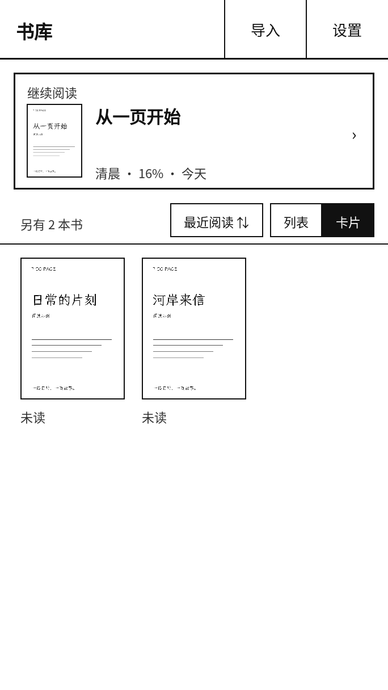
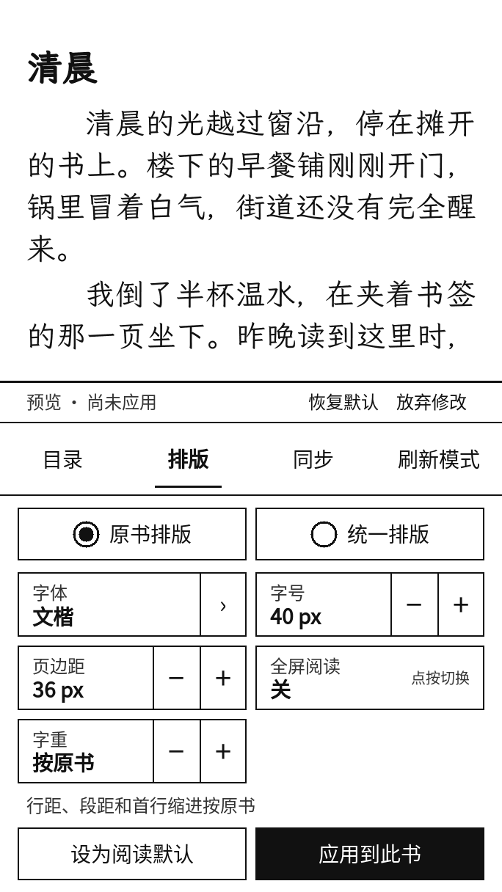

# Pico Page

**读自己的书，接着读下去。**

Pico Page 是为 Read Pico 墨水屏阅读器开发的阅读固件。把 EPUB、TXT 放进 TF 卡即可离线阅读，也可以与 KOReader 接续同一本 EPUB 的阅读位置。

[官网](https://picopage.wulu.zone/) · [安装固件](https://picopage.wulu.zone/install/) · [使用指南](docs/user/runtime.md) · [更新日志](https://picopage.wulu.zone/changelog/) · [文档导航](docs/README.md)

<p align="center">
  
  
  
</p>
<p align="center">书库 · 阅读 · 排版预览<br>固件界面预览，使用演示数据，非设备实拍。</p>

当前发布版本为 **0.4.0**，固件仍处于测试阶段，功能和兼容范围还会调整。仅支持 Read Pico；完整真机验收与长期稳定性验证仍在进行，具体范围见[开发状态](docs/development-status.md)。

## 能做什么

- **离线阅读**：直接打开 EPUB，以及 UTF-8、GB18030 编码的 TXT，无需预先转换为专有格式。支持目录、内部链接、PNG/JPEG 插图和图片放大查看。
- **按自己的习惯排版**：调整字体、字重、字号、行距、页边距、段距和首行缩进，先预览再应用；每本书可以保留独立设置。刷新提供清晰、均衡、快速三档。
- **接着上次读**：保存阅读位置、最近阅读和本地书签；使用 KOSync 与 KOReader 接续 EPUB 位置，由用户检查、选择和确认。
- **方便地放入文件**：支持 USB 文件传输、设备热点传书和同一 Wi-Fi 网络传书。书籍、字体、设置和阅读记录保存在 TF 卡上，便于备份。
- **选择休眠画面**：使用书籍封面、保留正文、简洁屏保或自定义图片；自定义图片支持固定、轮播，以及透明 PNG 叠加当前画面。

## 开始使用

准备一台 Read Pico、一张 FAT 文件系统的 TF 卡，以及支持数据传输的 USB 线。安装使用电脑版 Chrome 或 Edge。

**安装会清除设备内部闪存，替换原有固件、分区表和内部设置；TF 卡上的文件不受影响。** 安装前请阅读安装页的恢复说明，并备份需要保留的数据。

1. 打开[官方安装页](https://picopage.wulu.zone/install/)，按页面提示连接设备并安装。
2. 用读卡器或设备的 USB 文件传输，将书籍和字体放入 TF 卡。完整中文字体可从[官网字体区](https://picopage.wulu.zone/#fonts)下载，复制时保留许可证。
3. 插回 TF 卡后重启设备；使用 USB 文件传输时，先在电脑上安全弹出，再在设备上退出并确认重启。
4. 在书库打开一本书，轻点正文中部 →「排版」，选择字体，点击「应用到此书」或「设为阅读默认」。

```text
TF 卡/
├── Books/          EPUB、TXT，可建子文件夹
├── Fonts/          TTF、OTF 字体及其许可证
└── LockScreens/    PNG、JPEG 休眠图片，可选
```

内置字体包含 3,500 个常用汉字，未覆盖的字符会显示为方框，建议添加完整中文字体。设备不支持 TF 卡热插拔，取出或插入后需要重启。

已经安装 Pico Page 时，可在「设置 → 固件更新」中检查更新；条件与步骤见[固件更新](docs/user/runtime.md#固件更新)。设备中的「设置 → 使用说明」可离线查看。

## 按键与触摸

| 操作 | 结果 |
|---|---|
| K1 / K3，或点正文左侧 / 右侧 | 上一页 / 下一页 |
| 正文左右轻扫 | 翻页 |
| K2 | 立即全刷当前画面 |
| 点正文中部 | 打开阅读工具 |
| 长按书库条目 / 正文图片 | 查看书籍详情 / 放大图片 |
| 短按电源键 / 长按电源键 | 休眠 / 打开关机、重启菜单 |

K2 在所有可交互页面只全刷，不关闭面板、不确认或取消操作，也不退出传输。准备休眠期间，触摸和 K1/K2/K3 暂不响应；再短按电源键取消，长按仍打开电源菜单。

## 使用边界

- KOReader 接续要求两端使用内容完全相同的原始 EPUB 和同一同步账户。仅在位置能精确映射时提供接续，不按百分比猜测；TXT 和本地书签不参与同步。详见[操作步骤](docs/user/runtime.md#与-koreader-接续位置)和[兼容范围](docs/development/sync-runtime.md)。
- EPUB 使用统一正文排版，不完整还原原书样式；表格、复杂 SVG、复杂 CSS、复杂文字塑形和双向文字不在完整支持范围内。TXT 不支持 UTF-16。
- 暂不支持 PDF、批注、高亮、插件、阅读统计和多主题。自定义按键、蓝牙翻页等计划见[路线图](docs/planning/roadmap.md)，不代表当前可用。
- 移动或备份书籍时，请一并保留原书旁的 `<完整文件名>.picopage/` 目录；它保存这本书的进度、书签和设置。完整备份方法见[文件与备份](docs/user/runtime.md#文件与备份)。

## 构建固件

项目基于 **ESP-IDF v6.1**，板级支持固定到 Read Pico BSP 的指定提交。在仓库根目录运行：

```sh
python3 tools/setup_fonts.py
sh tools/build_firmware.sh
```

脚本复用已有工具链，首次下载固定版本的字体、渲染依赖及 BSP；应用产物为 `firmware/build/pico_page.bin`。脚本只构建，不烧录。依赖准备、分区和设备写入边界见[固件开发指南](firmware/README.md)，不要直接套用历史设备的写入偏移。

## 开发与参与

固件使用 C++，阅读逻辑由设备和桌面程序共用：UI 负责交互，session 管理阅读位置，display 管理面板刷新，store 管理文件提交。架构与边界见[架构说明](docs/development/architecture.md)。

| 路径 | 内容 |
|---|---|
| `firmware/` | ESP-IDF 工程、共享阅读组件与 Read Pico 适配 |
| `host/`、`tests/` | 桌面运行入口、回归测试和测试素材 |
| `tools/`、`examples/` | 构建与诊断脚本、TF 卡配置示例 |
| `web/`、`docs/` | 官网、使用文档、设计决定和验证记录 |

桌面程序可通过 `sh tools/run_host.sh` 启动，用法见[桌面开发指南](host/README.md)。提交改动前阅读 [AGENTS.md](AGENTS.md)，按改动范围执行[测试](tests/README.md)与[验收检查](docs/development/acceptance.md)。桌面运行、自动测试和固件构建均不能代替真机验证。

欢迎通过 [Issues](https://github.com/eMUQI/pico-page/issues) 报告问题。请提供固件版本、操作步骤、预期结果和实际结果；排版或同步问题可附不含私人内容的最小样本。不要上传账户凭据、个人 EPUB、完整 Flash 备份或未经检查的日志。功能取舍见[产品决定](docs/planning/decisions.md)。

## 致谢与许可证

感谢 [Read Pico](https://github.com/MindReset/read_pico_firmware) 的硬件与 BSP、[ESP-IDF](https://github.com/espressif/esp-idf)、epdiy，以及提供解析、字体和图像处理能力的第三方项目；也感谢 KOReader/CREngine、CrossPoint 等阅读器项目的公开资料。具体采用、修改与仅供研究的范围见[依赖审查](docs/development/dependency-review.md)和[调研参考](docs/planning/references.md)。

Pico Page 按 [GPL-3.0-or-later](LICENSE) 发布，并附加 ESP-IDF 二进制库链接许可。可以商用；分发固件或修改版时，须同时提供完整源码。修改版请勿以「Pico Page」名义发布或销售。适用范围、附加许可和名称使用见[许可说明](LICENSING.md)。

第三方组件保留各自的许可证和声明，例如 epdiy 使用 LGPL-3.0-or-later，随附字体使用 OFL 1.1。来源、固定版本及待完成的分发核对见[依赖审查](docs/development/dependency-review.md)与 [BSP 审查](docs/development/bsp-review.md)。
