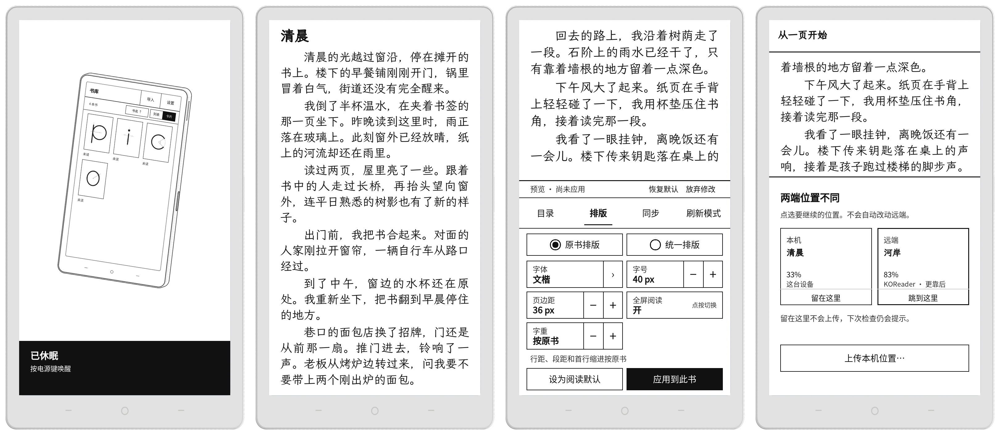

# Pico Page

**读自己的书，接着读下去。**

为 Read Pico 4.7 英寸墨水屏阅读器开发的开源阅读固件。把 EPUB、TXT 放进 TF 卡即可离线阅读，也可以与 KOReader 精确接续同一本 EPUB 的阅读位置。

[官网](https://picopage.wulu.zone/) · [安装固件](https://picopage.wulu.zone/install/) · [使用文档](https://picopage.wulu.zone/docs/) · [更新日志](https://picopage.wulu.zone/changelog/) · [仓库文档](docs/README.md)

<p align="center">
  <a href="docs/images/readme-device-gallery.webp">
    
  </a>
</p>
<p align="center">书库锁屏 · 全屏阅读 · 字号预览 · KOReader 接续<br>机身与桌面阅读器渲染画面合成，接续使用演示数据。</p>

> [!NOTE]
> Pico Page 仅支持 Read Pico，目前正在快速迭代，功能和界面会随版本更新。各版本的变化见[更新日志](https://picopage.wulu.zone/changelog/)。

## 主要特性

- **离线阅读**：直接打开 EPUB 与 TXT，支持目录、内部链接和插图放大；书籍、字体、设置与阅读记录均以普通文件保存在 TF 卡（格式支持范围见[使用指南](docs/user/runtime.md#格式与兼容范围)）。
- **可预览排版**：调整字体、字重、字号、行距、页边距、段距、首行缩进与全屏阅读，先预览再应用，支持单书独立设置；EPUB 默认按原书基础 CSS 排版（试验性），可随时切换为统一排版。
- **墨水屏刷新与多语言**：提供清晰、均衡、快速三档刷新，可交互页面按 `K2` 立即全刷；支持简体中文、繁體中文和 English 界面。
- **KOReader 接续**：保存本地进度与书签，也可通过 KOSync 与 KOReader 精确接续同一本原始 EPUB 的阅读位置；检查后由用户确认，不按百分比猜测，不自动改页或覆盖远端（见[同步说明](docs/development/sync-runtime.md)）。
- **多种传书与离线查词**：支持读卡器、USB 文件传输、设备热点与局域网 Wi-Fi 传书；安装 StarDict 词典后可长按正文离线查词（详见[离线词典](docs/user/runtime.md#离线词典)）。
- **自定义休眠画面**：支持书籍封面、保留正文、简洁屏保和自定义图片，自定义图片支持轮播与透明 PNG 叠加。

## 快速开始

需要 Read Pico 一台、FAT 文件系统的 TF 卡一张、支持数据传输的 USB 线，以及装有 Chrome 或 Edge 的电脑。

> [!WARNING]
> 安装会清除设备内部闪存，替换原有固件、分区表和内部设置；TF 卡上的文件不受影响。安装或重装前请阅读安装页的恢复说明，并备份重要数据。

1. 打开[官方安装页](https://picopage.wulu.zone/install/)，按提示连接 Read Pico 并安装固件。
2. 用读卡器或设备的「USB 文件传输」，将书籍放入 `Books/`，将完整中文字体放入 `Fonts/`（可从[官网字体区](https://picopage.wulu.zone/#fonts)下载）。
3. 插回 TF 卡后重启设备；使用 USB 文件传输时，先在电脑安全弹出，再在设备上退出并确认重启。
4. 打开一本书，轻点正文中部 →「排版」，选择字体并点击「应用到此书」或「设为阅读默认」。

```text
TF 卡/
├── Books/          EPUB、TXT，可建子文件夹
├── Fonts/          TTF、OTF 字体
├── LockScreens/    PNG、JPEG 休眠图片（可选）
└── Dictionaries/   StarDict 词典（可选）
```

内置字体仅含 3,500 个常用汉字，缺字会显示为方框，建议添加完整中文字体。设备不支持 TF 卡热插拔，插拔后需要重启；移动或备份书籍时请一并保留原书旁的 `<完整文件名>.picopage/` 目录（详见[文件与备份](docs/user/runtime.md#文件与备份)）。

按键与触摸操作（`K1`／`K3` 翻页、`K2` 全刷、电源键休眠与电源菜单）、[固件更新](docs/user/runtime.md#固件更新)及完整用法见[在线使用文档](https://picopage.wulu.zone/docs/)或仓库[使用指南](docs/user/runtime.md)，也可在设备「设置 → 使用说明」离线查看。

## 开发与构建

固件使用 C++，阅读核心由设备与桌面程序共用，职责划分见[架构说明](docs/development/architecture.md)。

| 路径 | 说明 |
|---|---|
| `firmware/` | ESP-IDF 工程、共享阅读组件与 Read Pico 适配 |
| `tools/` | 构建与诊断脚本、桌面阅读器入口 |
| `tests/` | 回归测试与测试素材 |
| `web/`、`docs/` | 官网、使用文档、配置示例、设计决定与验证记录 |

### 构建固件

基于 **ESP-IDF v6.1** 与固定提交的 Read Pico BSP，在仓库根目录运行：

```sh
python3 tools/setup_fonts.py
sh tools/build_firmware.sh
```

脚本复用已有工具链，首次会下载固定版本的字体、渲染依赖与 BSP，产物为 `firmware/build/pico_page_ota7.bin`（只构建，不烧录）。依赖准备、分区表与写入边界见[固件开发指南](firmware/README.md)，切勿套用历史设备的写入偏移。

### 桌面运行与参与贡献

- **桌面调试**：执行 `sh tools/run_host.sh` 启动桌面阅读器，详见[桌面开发指南](tools/host/README.md)。
- **测试与贡献**：提交改动前请阅读[贡献指南](.github/CONTRIBUTING.md)，按改动范围执行[测试说明](tests/README.md)与[验收清单](docs/development/acceptance.md)。桌面运行、自动测试与固件构建均不能代替真机验证。
- **问题反馈**：在 [Issues](https://github.com/eMUQI/pico-page/issues) 提供固件版本、复现步骤、预期与实际结果；请勿上传账户凭据、个人 EPUB、完整 Flash 备份或未经检查的日志。功能取舍与后续规划见[产品决定](docs/planning/decisions.md)与[路线图](docs/planning/roadmap.md)。

## 致谢

感谢 [Read Pico](https://github.com/MindReset/read_pico_firmware) 的硬件与 BSP、[ESP-IDF](https://github.com/espressif/esp-idf)、epdiy 及其他提供解析、字体与图像处理能力的第三方项目，也感谢 KOReader／CREngine、CrossPoint 等阅读器项目的公开资料。采用与修改范围见[依赖审查](docs/development/dependency-review.md)。

## 许可证

Pico Page 按 [GPL-3.0-or-later](LICENSE) 发布，并附加 ESP-IDF 二进制库链接许可。允许商用；分发固件或修改版时须同时提供完整源码，修改版请勿以「Pico Page」名义发布或销售。详见[许可说明](docs/LICENSING.md)。

第三方组件与随附字体保留各自许可（如 epdiy 使用 LGPL-3.0-or-later，随附字体使用 OFL 1.1），来源与固定版本见[依赖审查](docs/development/dependency-review.md)与 [BSP 审查](docs/development/bsp-review.md)。
