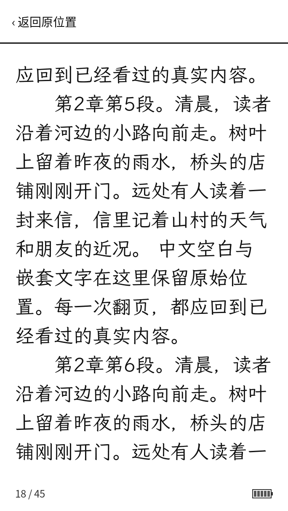
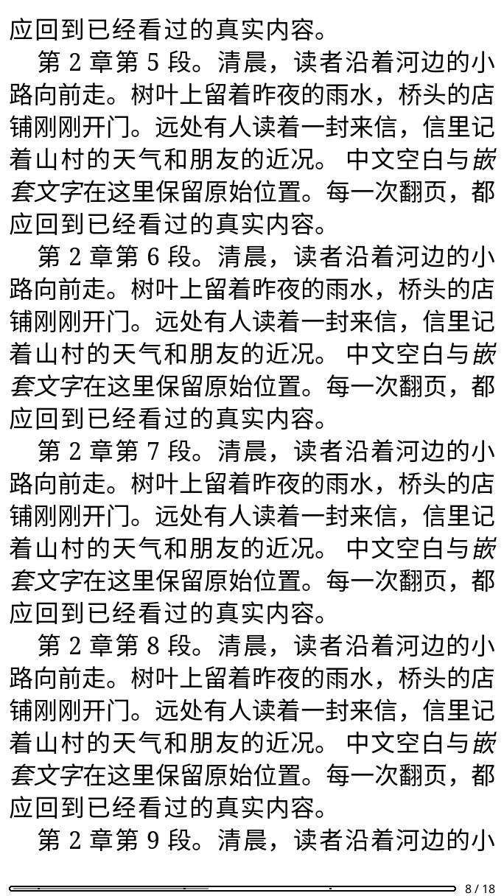
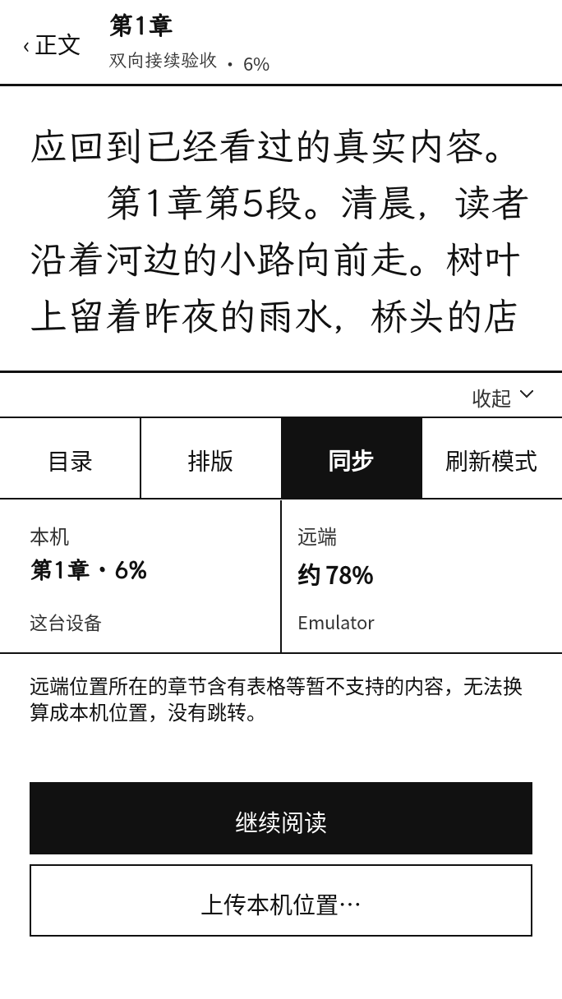

# KOReader 与 Read Pico 双向接续验收

2026-11-05，在一份原创合成 EPUB 上完成 Read Pico 与官方 macOS KOReader 经现有 HTTPS KOSync 服务的实际往返。两端字号分别为 46 px 和 28 px，跨章接续、回读、重开和无法映射时的进度保护均通过。验收依据为 [SYNC01–SYNC03](../acceptance.md#koreader-与网络)。维护者明确将 [#47](https://github.com/eMUQI/pico-page/issues/47) 的本次关闭范围限定为这组场景，本轮复核已通过。原总清单中的其他专项不作为本轮关闭条件，也不标记为已通过。

[结构化证据](2026-11-05-koreader-roundtrip.json)包含两端位置、源锚点、保存修订和状态快照。[原创测试书](2026-11-05-koreader-roundtrip.epub)可用于复验。账户、服务地址、设备身份、Flash 备份和原始日志留在私有证据目录，不随报告发布。

## 环境与样本

| 项目 | 本次条件 |
|---|---|
| 固件 | `5045a6d85c6da9a65308cbe996e638f58c8ed063`，原样 Diagnostic，`0.5.1+g5045a6d` |
| 固件镜像 | 4,075,264 字节，SHA-256 `5f7bbec7167e9d5414d4b374f2f1dda4f6dc0a214816ef869439d862f29a352a` |
| 工具链 | 既有 EIM ESP-IDF 6.1，SDK `fff9895c`，保留已有外部 RAM 链接脚本修改；BSP `5f3406d` |
| 实际客户端 | 官方 macOS ARM64 KOReader `v2026.07.2-220-g83f443c_2026-10-04_macos`，完整应用与原有 KOSync 插件，SDL dummy 显示 |
| 客户端来源 | commit `83f443ce4b3dfd2e3366b97bf3e3333dfc46718e`；官方包 SHA-256 `ec5342a53f85131cb7a903cd6ed550619e06b62899b95ba25cca3e13ff3fb258` |
| 样本 | 原创中文三章、每章 24 段，包含空白、内联强调，第三章含表格；3,900 字节 |
| 样本 SHA-256 | `6ea605ac5b2bfdf1ba2467530db4e3ffa38b32985291d9ef39be0bc979e8c544` |
| 两端配置 | Pico 46 px，KOReader 28 px；同一份 EPUB，均使用 DOM 20260812；手动同步，无自动上传 |
| 设备与服务 | 同一 Read Pico 和 TF，USB 供电；使用卡上已有网络及账户，真实外部 HTTPS 服务；鉴权与初始 GET 均为 HTTP 200，初始记录为空 |
| 缓存与样本数 | 新建独立卡内测试目录，未清全卡缓存；首开后沿用本轮热缓存；一份书、一次往返及一次回读，不作性能对照 |

官方包摘要核对通过。测试书在客户端和 TF 卡上的实际字节与原件一致。KOReader 使用隔离的配置目录，通过用户补丁入口调用原有插件的手动拉取、上传及正常翻页／章节导航；没有替换同步插件、引擎或服务端。Pico 经现有诊断口注入正常应用输入。两端原始位置和短正文均保留于本轮证据。

## 往返与回读结果

原始证据按 XHTML 资源、节点及 Unicode 标量偏移核对精确位置。公开结果只保留源锚点摘要，不发布原始位置串。设备状态中的 anchor 为资源、节点及偏移的 CRC32；另已读取 TF 上实际提交的主记录与备份。主记录 revision 5 和备份 revision 4 的完整资源、节点及偏移分别与回读、第二章远端位置精确相等。

| 步骤 | 源位置与结果 | Pico 已保存记录 |
|---|---|---|
| Pico 检查无记录 | `no-record`；检查前后锚点、修订和字号不变 | revision 3，`b5b7e15a` |
| Pico 上传，KOReader 拉取 | 第一章普通段落；服务记录反解后与 Pico 保存锚点一致。实际客户端采用同一 XPointer，24 字正文与原生反解一致，目标位于实际显示页内 | revision 3，`b5b7e15a` |
| KOReader 跨到第二章，翻页并上传 | 第二章普通段落；Pico 检查为 `different`、远端更靠后，确认前仍保持原记录 | revision 3，`b5b7e15a` |
| Pico 确认跳转并重开 | 源锚点精确等于远端，正文由「应回到已经看过的真实内容」接续；回书库重开后锚点、修订和字号不变 | revision 4，`ceac3068` |
| KOReader 回读第一章并上传，Pico 接续 | 第一章普通段落；Pico 判定远端更靠前，确认后采用较早的源位置 | revision 5，`f697bb1b` |

第一章起点在 Pico 为第 3 页，在 KOReader 为第 1 页。第二章接续点分别为第 18 页和第 8 页。页边界随字号不同，验收依据为源锚点、正文和目标所在显示页，不要求两端页码或页面首行相同。

以下是第二章同一位置的两端实际画布。它们证明应用绘制内容，不代表物理墨水屏光学验收。

| Pico 46 px | KOReader 28 px |
|---|---|
|  |  |

## 无法映射时保留两端进度

KOReader 导航至含表格的第三章，并真实上传普通段落内强调文字的位置。该位置本身位于文字节点，因所在章节含不支持结构，原生映射按现行边界拒绝。

Pico 检查结果为 `unmapped`，明确提示「远端位置所在的章节含有表格等暂不支持的内容，无法换算成本机位置，没有跳转」。没有注册「跳到这里」入口。点击原来的远端选择区域后仍停在同步页，本地 anchor `f697bb1b`、revision 5 和字号不变。随后选择「继续阅读」，正文画布 CRC32 恢复为检查前的 `882b16f4`。再次 GET 得到的完整远端记录与检查前相同，没有隐式上传覆盖。TF 实际保存记录也保持相同源锚点及 revision 5。



## 验证入口与恢复

本轮发现现有 `tools/check_koreader_client.py` 生成的独立 CMake 工程缺少板级 profile 和 `platform_contract`，当前源码编译因缺少 `pico_page/build_profile.h` 失败。补齐两项后，以同一测试书运行原 CLI，通过官方客户端上传、下载、原生精确位置恢复及重启检查。此 CLI 使用本机隔离服务，其结果与上文的真实设备／外部服务验收分别记录。

执行的已有入口如下。未新增测试。

```sh
python3 tools/check_koreader_client.py --help
python3 tools/check_koreader_client.py --book docs/development/baselines/2026-11-05-koreader-roundtrip.epub
cmake -S . -B build/host -DCMAKE_BUILD_TYPE=Debug
cmake --build build/host --parallel 4
ctest --test-dir build/host -N
ctest --test-dir build/host --output-on-failure
sh tools/build_firmware.sh diagnostic
python3 tools/check_handoff.py
git diff --check
```

关闭前重新完成 host Debug 配置、完整构建与注册核对，36 项 CTest 全部通过。原 CLI 的默认 28／38／56 px 三组均通过官方客户端上传、下载、原生精确位置恢复及重启检查；这些仍是本机隔离服务结果。Diagnostic 使用环境说明中的原有工具链构建，标准构建遇到 macOS `sysctl` 沙箱限制后，以相同命令和工具链获准重试通过。实际往返、TF 主记录与备份、远端记录保护和原固件恢复证据再次核对通过。未运行新的 sanitizer 或远端 CI。

实际设备操作前读取本次分区及 OTA 状态，备份原活动应用；Diagnostic 安装与原固件恢复分别独立校验。原 `0.5.1+ga2871cc` 已恢复，完整原应用槽验证通过，Flash 元数据与 otadata 不变，启动确认出厂 VCOM 和 TF 挂载正常。同步配置逐字恢复，DOM 回到原 20240114；阅读历史逐字恢复，原书旁文件在恢复前后相同。网络账户和选择未变，正常联网更新的连接时间与顺序予以保留。独立测试书及其测试服务记录留存，KOReader 已正常退出。

私有复验目录为 `.local/verification/kosync-47-20261105/`。`roundtrip.py`、`device.py`、`client-patch.lua`、`service.py` 及其逐步日志保留实际输入与断言；`roundtrip-results.json` 为整组结果。`card-after/test-sidecar/` 为 TF 提交记录副本，`card-restoration.json` 和 `install-original/result.json` 分别记录配置与固件恢复。原始文件可能含账户、设备身份和卡内路径，不应直接公开。

## 未测范围

本轮通过一份原创合成书的有限正常往返及一种拒绝分支。它不替代真实书籍、其他结构或 DOM 版本、跨分段长节点、脚注往返、多轮稳定性、断网／超时／鉴权失败、上传取消、低内存、TF 故障及长期资源验收。没有测量完整延迟分布和峰值内存；结构化结果中的能力堆值仅为状态查询快照。未覆盖实体按键／触摸和物理屏幕效果。设备日志按操作分段采集，客户端单独操作期间没有连续设备 trace，不宣称整段事件完整。上述未测范围沿用现行验收文档，不扩展本 issue。
