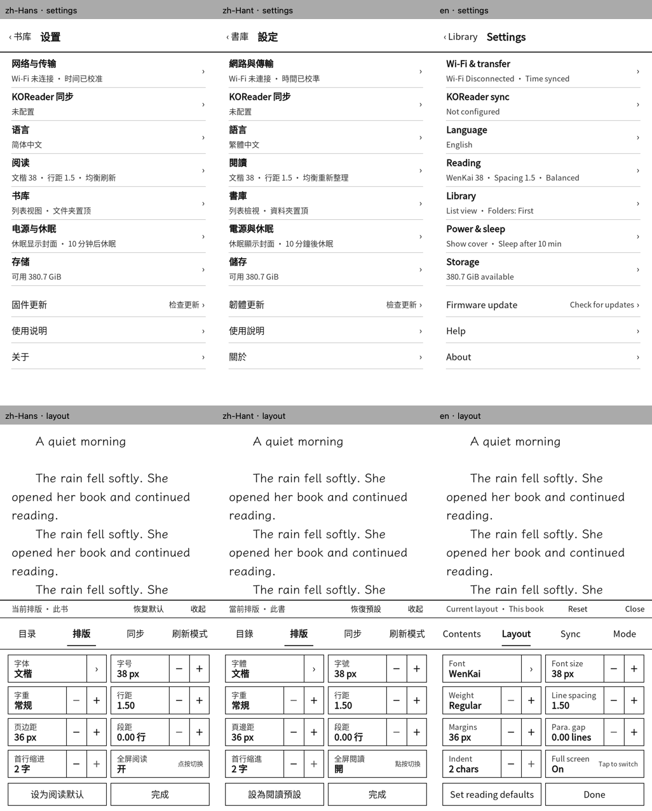

# 界面语言

固件的界面语言与正文排版独立。`reader_core` 的 `i18n::Language` 提供 `zh-Hans`（默认）、`zh-Hant` 和 `en`；`zh-Hant` 不绑定台湾或香港地区。繁体和英文译文仍在校对；官网和竖排阅读不在此实现中。

## 文案边界

应用通过 `tr()` 显式查询固件控制的菜单、按钮、状态、错误、引导和内置说明。简体源文案作为消息键，繁体和英文译文分别维护在 `firmware/components/reader_core/locales/zh-Hant.json` 与 `en.json`。不在通用绘制函数中转换文字，不转换书名、原书目录、正文、书签摘录、路径、SSID 或用户输入。未知键原样返回。带动态数据且影响语序的消息通过 `trf()` 使用完整模板和命名参数；数量使用「Books: {count}」等不依赖单复数的形式。原书标签保持原文，固件生成的无目录 TXT 标题和缺省章节编号使用当前语言。书库位置摘要缓存带语言标识，语言不一致时重新生成，不改变权威进度。

`i18n::text()` 接收明确的语言值，不使用可变的进程全局语言。编译期排序表及字符串位于只读数据段，二分查询返回静态字符串指针，不分配内存、不读卡、不新增任务或缓存。应用任务持有已生效的语言；网络请求携带语言快照，错误格式化保留 SSID 原文。字体继续使用既有的字宽和位图缓存预算；不新增复杂文字塑形、双向排版或逐字字体回退。

`i18n::format()` 在调用任务中格式化消息，最多接受 32 个命名参数，输出上限为 4096 字节。先检查长度与参数，再分配一个结果字符串；替换后的用户数据不再次解释为模板。缺少、重复或多余参数及长度超限返回未替换的译文，源模板自身超限返回空字符串。这是内部调用错误的保守回退，调用方必须提供有界参数，生成器校验各语言的占位符集合。该路径不新增 I/O、任务或等待；查询与格式化失败不改变保存状态。

传书网页的源模板是 `platform_read_pico/upload_page.h`，繁体和英文文案维护在同目录 `upload-zh-Hant.json` 与 `upload-en.json`，生成对应的 `upload_page_hant.h` 与 `upload_page_en.h`。开始传书时，在网络任务中从全局配置读取语言，HTTP 服务存活期间保持不变，结束服务后才可替换；请求不重新读取配置。页面选择发生在插入网络名和令牌之前，不转换上传文件名或用户数据。网页仍使用浏览器字体。

## 配置与失败处理

`PicoPage/settings.toml` 的 `[system].language` 接受 `"zh-Hans"`、`"zh-Hant"` 或 `"en"`，缺省为简体。未知值、错误类型和单书覆盖按现有配置诊断拒绝，不自动改写文件。旧固件会拒绝新字段，降级前需从全局配置移除 `system.language` 与新增的 `onboarding.in_progress`。

引导先显示独立的语言选择页，点「继续」进入欢迎页，欢迎页左上可返回修改；设置列表中的「语言」行位于「阅读」之前，下方显示当前语言，点整行进入语言页。选项使用各自原名「简体中文」「繁體中文」「English」，点按后复用现有快照比较、保注释编辑、验证与提交协议。成功后才更新内存语言、清除书库派生状态文案并重画页面；失败保留原语言，提示重新打开设置后重试。引导语言页保存失败就地提示重试，不进入错误页；首次保存语言会同时标记引导未完成，重启后保留语言并重新显示语言页，完成或跳过才清除此状态。重看引导不重置完成标记。K2 全刷当前页面，返回不改变语言。语言变化不修改正文参数、书籍标识、进度或同步协议。

## 多语言布局

沿用 684 × 1216 画布和现有字号层级。返回格与右侧值按真实字宽预留空间；窄工具入口使用短标签，完整名称保留在页面标题或说明。按钮在空间允许时居中显示两行，说明和存储提示按测量高度换行。帮助正文超出预留区域时收紧段间距，不缩小字号。原有中文内容能容纳时保留其尺寸与位置。

三语言需要对照语言页、引导、书库、阅读工具、设置、帮助各页、错误与保存失败状态。正常操作标签和风险提示不得依靠省略号隐藏含义；书名和文件名等用户内容允许沿用省略规则。桌面截图检查裁字、重叠、留白与热区，实体屏幕观感与触控单独验收。

设置页与排版面板的三语言对照如下，正文使用原创合成文本，由 host 渲染后并排展示。截图只用于检查文字、间距与控件布局，不证明真机成像或触摸表现。



## 维护与检查

新增文案需同时更新繁体和英文 JSON，确认语义和项目术语；不以逐字转换结果代替校对。文档层的固定中文错误也由界面边界查询翻译，生成器检查 TXT 诊断键是否齐全；未知诊断仍保留原文，不逐字转换。修改传书模板时同步更新其翻译键。运行：

```sh
python3 tools/generate_translations.py
python3 tools/generate_translations.py --check
.local/font-tools/bin/python tools/setup_fonts_subset.py
.local/font-tools/bin/python tools/setup_onboarding_font.py
```

字体工具环境按[字体说明](graphics-runtime.md#内置字体与许可)准备。生成字体包含三种语言的全部消息键和译文；源字体缺字时生成失败。普通固件构建只读取已提交的表和字体，不依赖翻译工具或 Python 字体工具。

`language` 测试检查排序查询、所有消息的真实字体覆盖、实际点按切换、K2、保存失败、外部配置冲突、重启恢复和单书隔离，同时覆盖同步与异步应用模式；实际打开空文件、空白文本、含 NUL、编码不支持及无效 UTF-16 的 TXT，验证三种语言的错误提示与原书字节保持不变。`provision` 检查三语言的 Wi-Fi 失败提示及原始网络名。`translations` 检查生成结果、界面与配网组件的显式文案键、参数集合及 TXT 中文诊断键；`wifi_upload_page` 覆盖三种语言的传书脚本及原始文件名，`portal_server` 检查服务存活期间的语言快照。桌面像素与文件系统故障注入不证明面板观感或 TF 掉电可靠。
